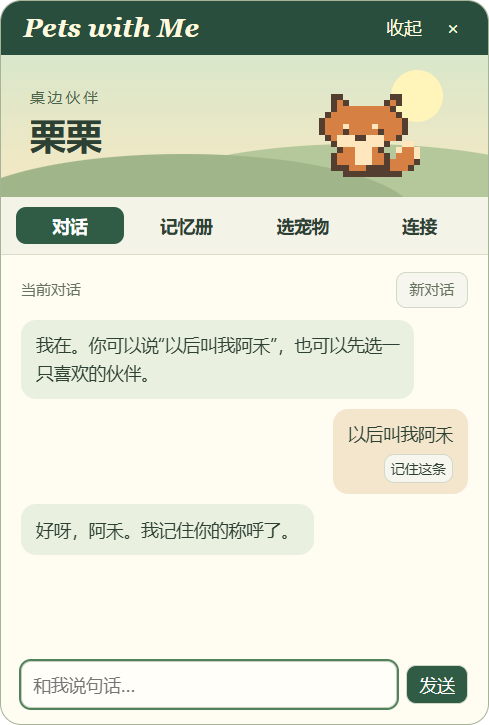

# Pets with Me · 桌边伙伴

一只住在 Windows 桌角的中文陪伴宠物。点开它聊两句，告诉它希望被怎样称呼，明天再见时它还记得。选宠物、看记忆和删记忆都有独立入口。



## 体验

1. 在[最新发布页](https://github.com/HEHEH1111/Pets-with-me/releases/latest)的 **Assets** 中下载 Windows x64 的 `.exe` 文件。升级时先右键宠物选「退出桌宠」，再双击新版。
2. 首次运行会打开设置。点「收起」即可体验离线模式，也可按下方步骤连接模型。收起后桌面只显示透明背景的宠物形象。
3. 在桌面上单击宠物展开聊天气泡，输入消息后按 Enter 发送。
4. 输入 **以后叫我阿禾**，退出重开后问 **你还记得怎么称呼我吗？**。这组指令离线也能使用。

### 鼠标操作

| 想做什么 | 怎么操作 |
| --- | --- |
| 打开或收起聊天气泡 | 对准宠物，轻点一下鼠标左键并松开。气泡打开时也可以点 × 或按 Esc 收起。 |
| 长按宠物 | 左键按住至少 0.4 秒再松开，气泡保持原来的状态。按住时动画暂停，鼠标在按下点附近轻微晃动也会留在原位。 |
| 移动宠物 | 按住宠物身体上的一点，拖到想放的位置再松开。被抓住的部位跟随鼠标；靠近屏幕边缘时，身体可以部分移出屏幕。可以立即拖动，无需先等 0.4 秒。 |
| 换形象、管理记忆、配置模型或退出 | 右键宠物，在菜单中选择相应功能。 |

## 连接通义千问（硅基流动）

1. **自行注册账号。** 首次打开桌宠，进入「模型连接」，点击「注册 / 获取硅基流动密钥」。在浏览器中注册或登录自己的硅基流动账号，按平台要求完成实名认证。[硅基流动控制台](https://cloud.siliconflow.cn/account/ak)
2. **创建自己的 API 密钥。** 在控制台的「API 密钥」页点击创建按钮，可以把名称填为「我的桌宠」。复制生成的完整密钥。每位使用者都用自己的账号和密钥，调用记录归对应的硅基流动账号。
3. **连接桌宠。** 回到桌宠，把密钥粘贴进「API 密钥」，点击「测试并连接」。首次使用时接口和模型已自动填好。旧版用户可以右键宠物 →「模型连接」→「使用通义千问」，再填写新的硅基流动密钥。原先保存的其他模型配置会在新连接测试成功后替换。
4. **开始聊天。** 测试成功后设置页会收起。点一下宠物，发送「今天有什么开心的事？」即可聊天。希望下次直接使用时，可在连接前勾选「用 Windows 加密保存密钥」。

| 默认设置 | 值 |
| --- | --- |
| 服务商 | 硅基流动（中国站） |
| 完整聊天接口 | `https://api.siliconflow.cn/v1/chat/completions` |
| 模型名称 | `Qwen/Qwen2.5-7B-Instruct` |

请按上表选择免费型号，当前定价和调用限制以硅基流动为准。出现 401 时，重新复制本账号创建的完整密钥；出现 429 时，暂停连续测试，稍后再试。也可手动填写其他兼容的聊天接口、模型名及对应密钥。[硅基流动价格](https://siliconflow.cn/pricing) · [聊天接口文档](https://docs.siliconflow.cn/docs/api/chat-completions-post)

## 记忆与数据

- **本次对话** 保留在进程内，每次模型请求附最近六轮。点击「新对话」或退出会清空。
- **长期记忆** 由用户主动保存。支持「以后叫我…」「记住…」、消息上的「记住这条」和记忆册手动录入。新称呼覆盖旧称呼。可查看、修改、删除，每台电脑有一本记忆册，切换形象会沿用。
- 使用在线模型时，本条消息、近期上下文、记忆册中的全部条目会发送给设置页所填服务。默认仅在本次运行中使用密钥。勾选记住后，密钥由 Windows 用户账户加密保存，启动时恢复。离线的称呼和记忆指令由本地规则处理。
- 配置和记忆以明文 JSON 保存在 Electron 用户数据目录，通常是 `%APPDATA%/Pets with Me/companion.json`。Petdex 图片缓存也在该目录。删除一条记忆后，新对话即可验证遗忘；旧聊天中已经显示的文字仍可见。
- 连接失败会保留输入，可修改设置后重新发送。查看记忆和已选形象可离线使用。

## 开发与打包

Windows x64，使用 Node.js 24 LTS 与 npm。在本仓库目录执行：

```powershell
npm ci
npx install-electron
npm start
```

`npm test` 运行记忆与模型接口测试。`npm run dist` 生成 Windows 便携版到 `dist/`。发布时将便携版附在 GitHub Release；仓库只提交源码、锁文件、文档及演示截图。

## 产品验证

第一版针对常在同一台电脑学习或工作的用户。希望验证用户是否愿意让一个轻量桌面伙伴记住少量关于自己的事。

| 体验任务 | 通过条件 |
| --- | --- |
| 改称呼 | 连续设置两次，重启后只读出最新称呼 |
| 忘记我 | 删去称呼并新开对话，宠物重新询问 |
| 换形象 | 从 Petdex 选择后，退出重开仍显示同一形象 |
| 接续对话 | 模型请求携带近期上下文和明确保存的记忆 |
| 断开模型 | 显示失败原因，消息留在输入框，可以重发 |

实现采用 Electron 主进程访问模型和本地文件，页面通过受限接口调用这些功能。记忆使用临时文件写入后重命名。下一轮试用重点记录用户能否独立完成「记住 → 找到 → 修改 → 删除」以及他们希望宠物记住哪类信息。

## 形象来源

内置的栗栗为本项目绘制。图库通过 [Petdex 公开目录](https://petdex.dev/api/manifest) 获取，界面列出投稿者。Petdex 源代码采用 MIT 许可证，宠物图片权利由各投稿者保留，具体授权请查看对应作品。发布包仅含内置形象，第三方形象按用户选择下载。[Petdex 项目和授权说明](https://github.com/crafter-station/petdex#license)

